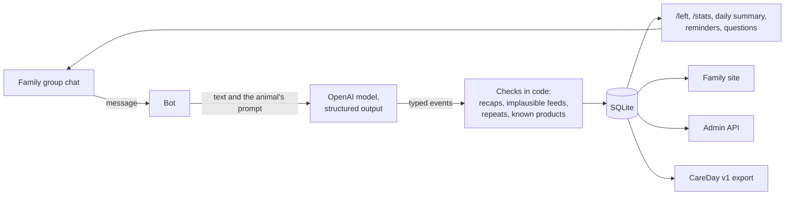

# Cat Care Telegram Bot

[](https://scorecard.dev/viewer/?uri=github.com/testprogmath/cat-care-telegram-bot)
[](https://www.bestpractices.dev/projects/15454)
[](https://github.com/testprogmath/cat-care-telegram-bot/actions/workflows/ci.yml?query=branch%3Amain)
[](https://github.com/testprogmath/cat-care-telegram-bot/blob/badges/prompt-eval.md)

A care diary for a seriously ill cat, kept by the people who live with her.

Nobody types structured data at 3am. They type "gave 30 ml through the tube, she pulled
free halfway" into the family group chat. This bot reads those messages, turns them into
structured events, and answers the question the vet asks at every visit: how much did she
actually eat and drink yesterday?

Written to keep one cat alive through a feeding tube, then extended to a second cat in a
second chat. Both are still using it.

## How it works

Every message in the group goes to an LLM with a per-animal prompt, and comes back as zero
or more typed events: medication with dose, water in ml and whether the cat drank it or was given it, food with
calories, refusals, litter box, body temperature, weight, breathing rate, general state.
Events land in SQLite. Commands and the daily summary read
from there.



The interesting part is everything the prompt has to get right, because a diary that
silently miscounts is worse than no diary:

- **Offered is not eaten.** "Put down 12 g" creates no event. "Ate 6 g" does. For tube
  feeds it inverts: "gave 30 ml through the tube" is an actual feed. "Would not touch the
  Urinary Care" is a refusal, recorded with the product name and never counted as food.
- **Water comes from food too.** Each wet product carries its own moisture fraction from
  the manufacturer's label, not a flat guess. 50 g of a pouch at 78.2% moisture is 39.1 ml
  of water toward the daily goal.
- **Recipes are not feeds.** "Diluted 50 g of pâté with 50 ml of water" describes
  preparation. No event.
- **Homographs bite.** In Russian, *вырвалась* means "struggled free" and *вырвало* means
  "vomited". One letter apart, and vomiting is a reason to call the clinic tonight.
- **Daily recaps are not intake.** A message summing up the day must not be counted again.

Each named product the cats actually eat is in the prompt with its label figures, so
"32 kibbles" becomes 7.1 g becomes 28 kcal rather than a number made up on the spot. The
code then checks the answer before it is stored: it drops daily recaps, rejects
implausible tube feeds and merges repeated reports. [The parser](docs/parser.md) has an
example and the full list.

## How it is checked

A prompt edit can quietly start writing the wrong calories, and nobody notices until the
vet asks why the numbers look odd. So the checks start with the prompt.

- A promptfoo regression set of 43 kinds of real messages (count from `evals/cases.yaml`
  on 22.10.2026), each with the events it must produce, runs through the bot's own parser
  against the live model on every pull request that touches the parser, the prompts or the
  profiles. Each failure shows in the job summary with the reason.
- 363 pytest tests cover the deterministic part, at 86% line coverage (local run on
  22.10.2026). octocov comments the change in coverage on each pull request.
- Hypothesis hunts for counterexamples to rules that must hold for any input: every
  instant of a care day's window belongs to that day, the nights the clocks change
  included, and a resent report adds nothing.
- ClusterFuzzLite runs Atheris fuzzers over the toilet classifier, product names, dose
  normalisation and the care-day boundary for two minutes on each pull request that changes
  the code and half an hour every Sunday, and posts the result on the pull request.
- CI builds the Docker image and runs a smoke test inside it, which catches a prompt file
  left out of the image and a Python version that drifted from `.python-version`.
- Dependencies are locked by hash, actions pinned to commits and images to digests.
  Releases are signed with Sigstore. CodeQL, zizmor and gitleaks run on every pull request, and
  the repository holds an [OpenSSF Scorecard](https://scorecard.dev/viewer/?uri=github.com/testprogmath/cat-care-telegram-bot)
  of 8.1 (21.10.2026) and the OpenSSF Best Practices passing badge.

[Development](docs/development.md) has the commands and how each check is wired.

## Commands

| | |
|---|---|
| `/stats` | today's diary; `/stats 2026-08-03` for a given day, `/stats 09:00` for the 24 hours from that time |
| `/left` | water and calories so far, and what remains; also sent as a reply to every message that adds calories |
| `/autoleft` | turn that automatic reply off or on: `/autoleft off`, `/autoleft on` |
| `/risk` | end-of-day projection from the current pace |
| `/week` | four charts: water, calories, litter box, temperature |
| `/meds` | medications for the last seven days as a grid of doses per day; `/meds all` for the whole diary, `/meds 2026-09-01 2026-09-30` for a period, both followed by a chart of doses over time |
| `/profile` | which animal this chat keeps; `/profile <имя>` assigns a free one |
| `/limit` | the daily food and water goals; `/limit food 225`, `/limit water 340`, `/limit food default` |
| `/reminders` | whether water reminders, check-ins and the daily summary run; `/reminders off`, `/reminders on` |
| `/help` | what the bot does and how it counts |

A summary is posted at the start of each care day, midnight by default. Water reminders
come every two hours between 09:00 and 23:00, only when the animal is behind the day's
schedule, and say how far behind. A stool reported without its consistency gets a question
for a score on a 1 to 5 scale, and a chat quiet for three hours between 09:00 and 22:00 gets
a check-in. [Animals, goals and reminders](docs/animals.md) has the rules, including the
pause while a cat is in hospital.

The family also gets [web pages](docs/web.md) with the same diary: the week, every day by
the hour, medications, foods and refusals.

## Running it

```bash
cp .env.example .env
docker compose up -d --build bot
```

The bot needs only `TELEGRAM_BOT_TOKEN` and `OPENAI_API_KEY`. The `api` and `web`
containers each need their own secrets and do not start without them; see
[configuration](docs/configuration.md). The database lives in `./data/`, mounted as a
volume, and survives rebuilds.

In BotFather, disable privacy mode for the bot, otherwise it never sees ordinary group
messages. Then add the bot to a chat and assign the animal with `/profile <имя>`.

## Documentation

- [The parser](docs/parser.md): an example answer, the checks after the model, what
  happens when parsing fails.
- [Animals, goals and reminders](docs/animals.md): one chat per animal, the tube,
  thresholds, reminders, the hospital pause.
- [CareDay v1 export](docs/care-day-export.md): the contract for downstream tools.
- [Admin API](docs/admin-api.md): fixing and adding diary rows, moving a diary.
- [Web pages](docs/web.md): sign-in, who sees what, Caddy.
- [Configuration](docs/configuration.md): every environment variable, and which secrets
  matter.
- [Releases and deploys](docs/deploy.md): labels, the deploy key, rollback, setup.
- [Development](docs/development.md): tests and CI.
- [Decisions](docs/decisions.md): four times the diary was wrong, by how much, and what changed.
- [What the diary does not yet watch](docs/monitoring-gaps.md): monitoring a vet ward does and this diary does not, in order of value.
- [Contributing](CONTRIBUTING.md): reporting a bug, proposing a change, the test policy.
- [Security](SECURITY.md): reporting a vulnerability, and where the sensitive parts are.

Python 3.14, python-telegram-bot, APScheduler, matplotlib, FastAPI, SQLite. No ORM, no
migrations framework.

## Limits

- The classification rules live in the prompt, so they are model judgements. The
  regression set checks 43 messages against the live model, but the model is not
  deterministic: a green run is evidence, not proof, and a message unlike every case can
  still be misread.
- Parsing is written for Russian-language chats. Messages in other languages are handled
  only as far as the model follows the prompt.
- One animal per chat, one running instance, one SQLite file.
- The diary records what people report. It does not give medical advice, and the alarm
  thresholds belong to one specific animal; they are not general clinical guidance.
